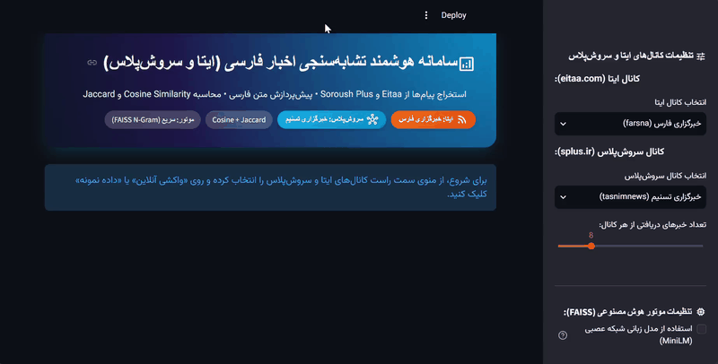
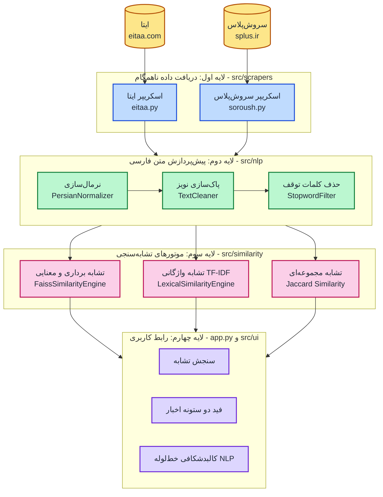
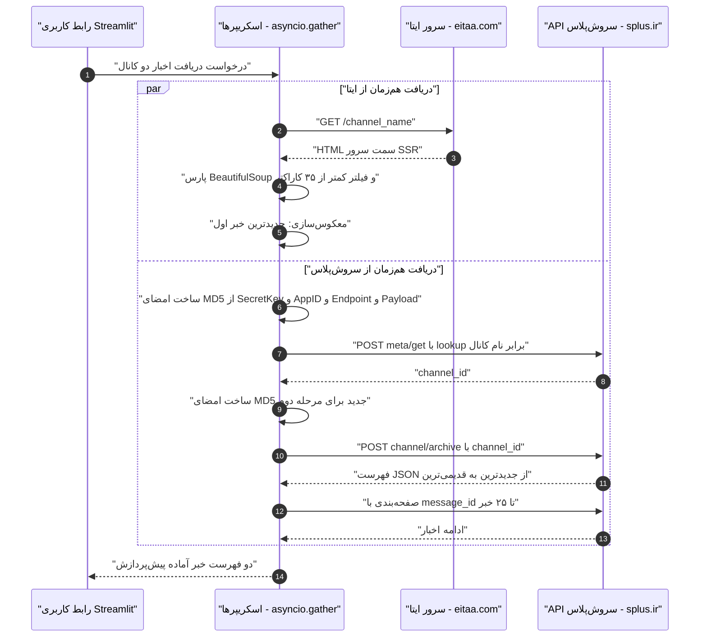
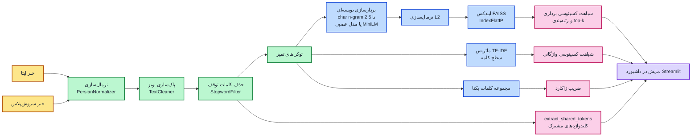

<div align="center">

# 📰 سامانه هوشمند استخراج و تشابه‌سنجی اخبار فارسی (ایتا و سروش‌پلاس)
### Persian News Similarity Engine — Eitaa & Soroush Plus

**دریافت بلادرنگ و ناهمگام اخبار از ایتا و سروش‌پلاس، پیش‌پردازش تخصصی زبان فارسی و سنجش شباهت با سه الگوریتم داده‌کاوی**

[](https://www.python.org/)
[](https://streamlit.io/)
[](https://github.com/facebookresearch/faiss)
[](https://scikit-learn.org/)
[](https://huggingface.co/sentence-transformers/paraphrase-multilingual-MiniLM-L12-v2)
[](#-اجرای-تست‌های-خودکار-unit-tests)
[](./LICENSE)

**توسعه‌دهنده:** [Kian Shojaei](https://github.com/KianShojaei) &nbsp;|&nbsp; **پروژه درس:** داده‌کاوی (Data Mining)

</div>

---

## 🎯 معرفی و هدف پروژه

یک سامانه جامع، ناهمگام (Asynchronous) و مهندسی‌شده در سطح Production برای درس **داده‌کاوی (Data Mining)** و **پردازش زبان طبیعی (NLP)** که آخرین اخبار عمومی را به‌صورت بلادرنگ (Real-time) از دو پیام‌رسان بومی **ایتا (`eitaa.com`)** و **سروش‌پلاس (`splus.ir`)** استخراج کرده، متن فارسی را طی یک خط‌لوله (Pipeline) سه‌مرحله‌ای پالایش می‌کند و میزان تشابه دو خبر را با سه معیار ریاضی **تشابه کسینوسی برداری (FAISS Cosine Similarity)**، **تشابه کسینوسی واژگانی (TF-IDF Cosine Similarity)** و **تشابه مجموعه‌ای ژاکارد (Jaccard Similarity)** مورد سنجش و رتبه‌بندی قرار می‌دهد.

---

## 🎥 ویدیوی دموی محیط برنامه (Project Demo Video)

در پیش‌نمایش زنده زیر می‌توانید نحوه کارکرد بلادرنگ سامانه، استخراج هم‌زمان اخبار از ایتا و سروش‌پلاس، محاسبه معیارهای تشابه کسینوسی و ژاکارد، نمایش کلیدواژه‌های مشترک و مراحل پیش‌پردازش متن فارسی (در هر دو تم روشن و تاریک) را مشاهده فرمایید:

<div align="center">
  <a href="https://github.com/KianShojaei/persian-news-similarity-engine/raw/main/Video/demo.mp4">
    
  </a>
  <br/><br/>
  <p>🎬 <b><a href="https://github.com/KianShojaei/persian-news-similarity-engine/raw/main/Video/demo.mp4">▶️ مشاهده یا دانلود ویدیوی کامل دمو با کیفیت اصلی (demo.mp4)</a></b></p>
</div>

> 💡 **راهنمای تماشا:** پیش‌نمایش متحرک بالا به‌صورت خودکار اجرا می‌شود؛ برای دانلود یا تماشای ویدیوی کامل با کیفیت اصلی روی لینک بالا کلیک کنید.

---

## 📌 معماری کلان سیستم (System Architecture)

معماری این سامانه بر پایه طراحی ماژولار و جداسازی کامل لایه‌ها (Separation of Concerns) در ۴ لایه اصلی پیاده‌سازی شده است که خروجی هر لایه ورودی لایه بعدی است:



---

## 🛠️ چالش‌های وب‌اسکریپینگ و نحوه غلبه بر آن‌ها (Scraper Engineering)

یکی از مهم‌ترین چالش‌های فنی این پروژه، تفاوت بنیادین معماری وب در دو پیام‌رسان **ایتا** و **سروش‌پلاس** بود که بدون استفاده از ابزارهای سنگین و کندی مثل Selenium یا Playwright، صرفاً با درخواست‌های ناهمگام (`httpx.AsyncClient` و `asyncio.gather`) حل شد:

### ۱. نحوه عملکرد اسکریپر ایتا (`EitaaScraper`)
* سرور ایتا در آدرس `https://eitaa.com/{channel}` یک صفحه SSR (Server-Side Rendered) برمی‌گرداند که پیام‌ها در تگ‌های `div.etme_widget_message_text` قرار دارند.
* چالش اول در ایتا این است که پیام‌ها در HTML از **قدیمی‌ترین (بالای صفحه) به جدیدترین (پایین صفحه)** چیده شده‌اند. اسکریپر ما لیست نودها را معکوس (`reversed`) می‌کند تا همیشه **خبر شماره ۱، جدیدترین خبر منتشرشده در کانال** باشد.
* همچنین تگ‌های `<br>` پیش از استخراج متن با فاصله جایگزین می‌شوند تا کلمات دو خط متوالی به هم نچسبند و پیام‌های کوتاه‌تر از ۳۵ کاراکتر (مانند استیکرها یا کپشن‌های تک‌کلمه‌ای) فیلتر می‌شوند.

### ۲. مهندسی معکوس API امضاشده سروش‌پلاس (`SoroushScraper`)
* **چالش بزرگ:** برخلاف ایتا، وقتی به آدرس `https://splus.ir/{channel}` درخواست HTTP زده می‌شود، سرور تنها یک پوسته خالی React (`<div id="root"></div>`) به همراه پیام `You need to enable JavaScript to run this app` برمی‌گرداند و هیچ متنی از خبرها در HTML وجود ندارد!
* **راه‌حل مهندسی‌شده:** با تحلیل باندل جاوااسکریپت ویترین سروش‌پلاس (`vitrin.splus.ir`)، مکانیزم ارتباطی کلاینت با سرور کشف و در پایتون بازتولید شد. سرور سروش‌پلاس برای هر درخواست، یک **امضای دیجیتال مبتنی بر هش `MD5`** تولید می‌کند:

$$\text{Signature} = \text{MD5}\left(\text{SecretKey} \;\Vert\; \text{"json"} \;\Vert\; \text{AppID} \;\Vert\; \text{Endpoint} \;\Vert\; \text{Payload}\right)$$

درخواست `POST` به این نشانی ارسال می‌شود:
```text
https://vitrin.splus.ir/srvcs-app/v1/json/{AppID}/{MD5_Signature}/{Endpoint}
```

### 🔄 نمودار توالی واکشی هم‌زمان (Sequence Diagram)



* به لطف این معماری: برنامه در کسری از ثانیه، بدون نیاز به اجرای مرورگر، آخرین اخبار هر کانال سروش‌پلاس را دقیقاً از **جدیدترین پیام به سمت پیام‌های قبلی** (کاملاً هم‌تراز با ایتا) واکشی می‌کند و در صورت نیاز به تعداد خبرهای بیشتر (مثلاً ۲۵ خبر)، صفحه‌بندی (Pagination) را با پارامتر `message_id` ادامه می‌دهد.

---

## 🧹 خط‌لوله پیش‌پردازش متن فارسی (Persian NLP Pipeline)

مقایسه مستقیم متون خام خبری به دلیل تفاوت در کیبوردهای عربی/فارسی، لینک‌های تبلیغاتی انتهای پیام‌ها و افعال ربط، دقت الگوریتم‌های داده‌کاوی را به شدت کاهش می‌دهد. به همین منظور، هر خبر پیش از ورود به موتور تشابه‌سنجی در کلاس `PersianNLPPipeline` از ۳ مرحله زیر عبور می‌کند:

| مرحله | ماژول | عملیات انجام‌شده | نمونه تغییر روی متن |
| :--- | :--- | :--- | :--- |
| **۰. متن خام** | `Scraper` | دریافت متن اولیه از ایتا و سروش‌پلاس | `بانك مركزي در https://splus.ir/tasnim اعلام كرد: سود ۳۰٪ ابلاغ شد! 🚀 @tasnim` |
| **۱. نرمال‌سازی** | `PersianNormalizer` | تبدیل حروف عربی (`ي` به `ی`، `ك` به `ک`، `ة` به `ه`)، حذف کامل اعراب و تشدید (دسته یونیکد `Mn`) و استانداردسازی نیم‌فاصله (`\u200c`) | `بانک مرکزی در https://splus.ir/tasnim اعلام کرد: سود ۳۰٪ ابلاغ شد! 🚀 @tasnim` |
| **۲. پاک‌سازی نویز** | `TextCleaner` | حذف URLها (`eitaa.com`, `splus.ir`, `http`)، منشن‌ها (`@`)، ایموجی‌ها، اعداد فارسی/عربی/انگلیسی و علائم نگارشی | `بانک مرکزی در اعلام کرد سود ابلاغ شد` |
| **۳. حذف کلمات توقف** | `StopwordFilter` | حذف بیش از ۱۲۰ کلمه توقف (Stopwords) پرتکرار فارسی (*از، به، در، که، کرد، شد، است...*) و حروف تک‌کاراکتری | `بانک مرکزی اعلام سود ابلاغ` |

علاوه بر این، متد `extract_shared_tokens` اشتراک کلمات کلیدی باقی‌مانده بین دو خبر را استخراج کرده و در رابط کاربری به عنوان **کلیدواژه‌های مشترک** نمایش می‌دهد.

---

## 📐 مبانی ریاضی و الگوریتم‌های تشابه‌سنجی (Similarity Metrics)

طبق اصول درس داده‌کاوی، این سامانه به جای اکتفا به یک عدد، تشابه دو خبر را از **۳ دیدگاه ریاضی مکمل** محاسبه و مقایسه می‌کند:

### ۱. تشابه کسینوسی واژگانی (Lexical TF-IDF Cosine Similarity)
در این روش، ابتدا برای دو خبر پالایش‌شده، ماتریس **TF-IDF** (حاصل‌ضرب فراوانی واژه در عکس فراوانی سند) با پشتیبانی از نیم‌فاصله فارسی ساخته می‌شود:

$$\text{TF-IDF}(t, d) = \text{TF}(t, d) \times \left( \ln\frac{1 + N}{1 + \text{DF}(t)} + 1 \right)$$

سپس زاویه کسینوسی بین دو بردار وزن‌دار $\mathbf{x}_{\text{tfidf}}$ و $\mathbf{y}_{\text{tfidf}}$ محاسبه می‌گردد:

$$S_{\text{lexical}}(\mathbf{x}, \mathbf{y}) = \cos(\theta) = \frac{\mathbf{x}_{\text{tfidf}} \cdot \mathbf{y}_{\text{tfidf}}}{\|\mathbf{x}_{\text{tfidf}}\|_2 \, \|\mathbf{y}_{\text{tfidf}}\|_2} \in [0, 1]$$

* **تحلیل:** این معیار زمانی نمره بالا می‌دهد که هر دو خبرگزاری از **واژگان دقیقاً یکسان** استفاده کرده باشند.

---

### ۲. تشابه کسینوسی برداری و معنایی با FAISS (`FaissSimilarityEngine`)
در دنیای واقعی، دو خبرگزاری ممکن است یک خبر واحد را با مشتقات واژگانی متفاوت (مثلاً *«بارش‌ها»* و *«بارندگی»*) یا کلمات هم‌معنی (مثلاً *«تورم»* و *«گرانی»*) منتشر کنند. در این حالت TF-IDF معمولی نمره پایینی می‌دهد.

برای حل این مشکل، بردارهای متراکم (Dense Embeddings) به طول واحد ($L_2$ Normalized: $\|\mathbf{u}\|_2 = \|\mathbf{v}\|_2 = 1$) ساخته شده و وارد نمایه‌ساز برداری **`faiss.IndexFlatIP`** (محصول پژوهشی Meta AI) می‌شوند. از آنجا که بردارها نرمال شده‌اند، ضرب داخلی (Inner Product) در FAISS دقیقاً برابر با **Cosine Similarity** است:

$$S_{\text{FAISS}}(\mathbf{u}, \mathbf{v}) = \cos(\theta) = \frac{\mathbf{u} \cdot \mathbf{v}}{\|\mathbf{u}\|_2 \|\mathbf{v}\|_2} = \sum_{i=1}^{D} u_i v_i$$

#### 💡 چرا از معماری دوحالته (Dual-Mode FAISS) استفاده کردیم؟
ما در این پروژه یک قابلیت هوشمند در نوار کناری برنامه تعبیه کرده‌ایم:
1. **حالت پیش‌فرض و فوق‌سریع (Fast Character N-Gram FAISS):** بدون نیاز به دانلود هیچ مدل حجیمی، کلمات را به زیرواژه‌های ۲ تا ۵ کاراکتری (`char_wb`) با مقیاس لگاریتمی (`sublinear_tf`) تجزیه کرده و در FAISS جستجو می‌کند. این روش در **کمتر از ۰.۰۱ ثانیه** اجرا شده و تمام ریشه‌ها، پسوندها و پیشوندهای مشترک فارسی را تشخیص می‌دهد.
2. **حالت شبکه عصبی عمیق (Optional Lightweight Neural Model - `MiniLM-L12-v2`):** در صورتی که کاربر گزینه مربوطه را در سایدبار فعال کند، مدل زبانی چندزبانه `paraphrase-multilingual-MiniLM-L12-v2` بارگذاری شده و جملات را به بردارهای ۳۸۴ بعدی معنایی تبدیل می‌کند. این مدل حتی اگر دو خبر هیچ کلمه مشترکی نداشته باشند اما مفهوم یکسانی را برسانند، تشابه کسینوسی بالایی را کشف می‌کند.

---

### ۳. تشابه مجموعه‌ای ژاکارد (Jaccard Set Similarity)
به عنوان سومین معیار کلاسیک داده‌کاوی، هر خبر به مجموعه‌ای از توکن‌های یکتا ($A$ و $B$) تبدیل شده و نسبت اندازه اشتراک دو مجموعه به اجتماع آن‌ها محاسبه می‌شود:

$$J(A, B) = \frac{|A \cap B|}{|A \cup B|} = \frac{|A \cap B|}{|A| + |B| - |A \cap B|} \in [0, 1]$$

---

### 📊 جدول مقایسه موتورهای تشابه‌سنجی

| ویژگی | FAISS (`IndexFlatIP`) | TF-IDF Cosine | Jaccard Similarity |
|:---|:---:|:---:|:---:|
| **سطح تحلیل** | زیرکلمه (N-Gram) یا معنایی (MiniLM) | کلمه (Word-Level) | مجموعه کلمات یکتا (Set) |
| **نوع شباهت** | برداری / معنایی | واژگانی وزن‌دار | مجموعه‌ای |
| **وزن‌دهی واژه‌ها** | بله ($L_2$ Sublinear / Dense) | بله (IDF) | خیر |
| **درک هم‌معنی‌ها** | بله (در حالت عصبی MiniLM) | خیر | خیر |
| **مقاومت در برابر تغییر صرفی** | بسیار بالا | کم | کم |
| **سرعت اجرا** | بسیار سریع | بسیار سریع | آنی |
| **کاربرد اصلی** | رتبه‌بندی خودکار و کشف مشابه‌ترین خبر | سنجش دقیق هم‌پوشانی واژگان کلیدی | نمای سریع هم‌پوشانی واژگان |

---

### 🔀 نمودار خط‌لوله داده‌کاوی (Data Mining Pipeline)



---

## 🌟 قابلیت‌های کلیدی رابط کاربری (Key UI Features)

* **پشتیبانی کامل از راست‌به‌چپ (RTL) و فونت وزیرمتن (`Vazirmatn`):** طراحی بصری استاندارد با آیکون‌های برداری رسمی گوگل (`Material Symbols Rounded`).
* **سازگاری کامل با هر دو تم روز (Light Mode) و شب (Dark Mode):** استفاده از متغیرهای تطبیقی CSS بدون به‌هم‌ریختگی رنگ‌ها.
* **کشف خودکار مشابه‌ترین خبر (Auto Best-Match Discovery):** کاربر می‌تواند یک خبر از ایتا انتخاب کند تا موتور FAISS در کسری از ثانیه بین تمام خبرهای استخراج‌شده از سروش‌پلاس بگردد، مشابه‌ترین خبر را پیدا کند و جدول رتبه‌بندی کامل (Ranking List) را نمایش دهد.
* **نمایش کلیدواژه‌های مشترک:** استخراج و نمایش تگ‌های واژگانی مشترک بین دو خبر.
* **کالبدشکافی مرحله‌به‌مرحله NLP:** نمایش خروجی هر ۴ مرحله پیش‌پردازش متن برای هر دو خبر در تب مجزا.
* **حالت داده نمونه آفلاین (Offline Demo Mode):** امکان تست و ارائه کامل پروژه حتی در صورت قطع بودن اینترنت.

---

## 📂 ساختار درختی پروژه (Project Structure)

```text
persian-news-similarity-engine/
├── Video/
│   ├── preview.gif             # پیش‌نمایش متحرک زنده در README
│   └── demo.mp4                # ویدیوی کامل دموی محیط برنامه
├── app.py                      # نقطه ورود اصلی اپلیکیشن Streamlit
├── config.py                   # تنظیمات سراسری و اعتبارسنجی با Pydantic v2
├── requirements.txt            # لیست وابستگی‌ها و کتابخانه‌های پایتون
├── .env.example                # الگوی متغیرهای محیطی
├── LICENSE                     # مجوز انتشار MIT
├── README.md                   # مستندات جامع پروژه
│
├── src/
│   ├── scrapers/               # لایه اول: واکشی ناهمگام اخبار
│   │   ├── __init__.py
│   │   ├── base.py             # کلاس پایه HTTP ناهمگام و مدیریت خطاها
│   │   ├── eitaa.py            # اسکریپر وب ایتا (eitaa.com)
│   │   └── soroush.py          # کلاینت API امضاشده (MD5) و پارسر سروش‌پلاس (splus.ir)
│   │
│   ├── nlp/                    # لایه دوم: پردازش زبان طبیعی فارسی
│   │   ├── __init__.py         # کلاس ارکستریتور PersianNLPPipeline
│   │   ├── normalizer.py       # یکسان‌ساز حروف، اعراب‌زدا و اصلاح نیم‌فاصله
│   │   ├── cleaner.py          # حذف لینک، منشن، ایموجی، اعداد و علائم نگارشی
│   │   └── stopwords.py        # فیلتر ۱۲۰+ کلمه توقف فارسی
│   │
│   ├── similarity/             # لایه سوم: الگوریتم‌های داده‌کاوی و تشابه‌سنجی
│   │   ├── __init__.py
│   │   ├── faiss_engine.py     # موتور جستجوی برداری FAISS (دوحالته: N-Gram و MiniLM)
│   │   └── lexical_engine.py   # موتور TF-IDF Cosine Similarity و Jaccard Similarity
│   │
│   └── ui/                     # لایه چهارم: نمایش و رابط کاربری
│       ├── __init__.py
│       ├── styles.py           # استایل‌های تطبیقی CSS، فونت وزیرمتن و تنظیمات RTL
│       └── components.py       # کامپوننت‌های کارت‌های امتیاز، مقایسه و رتبه‌بندی
│
└── tests/                      # مجموعه تست‌های واحد (۲۱ تست خودکار Pytest)
    ├── __init__.py
    ├── test_nlp.py             # تست‌های نرمال‌ساز، پاک‌ساز و کلمات توقف
    ├── test_scrapers.py        # تست‌های استخراج پیام از ایتا و سروش‌پلاس
    ├── test_similarity.py      # تست‌های ریاضی Cosine Similarity، FAISS و Jaccard
    └── test_ui.py              # تست‌های دسته‌بندی امتیازات و استایل‌ها
```

---

## 🚀 راهنمای نصب و اجرا (Quickstart Guide)

### ۱. دریافت پروژه و ساخت محیط مجازی (`.venv`)
```powershell
git clone https://github.com/KianShojaei/persian-news-similarity-engine.git
cd persian-news-similarity-engine

python -m venv .venv
# فعال‌سازی در ویندوز (PowerShell):
.\.venv\Scripts\Activate.ps1
# فعال‌سازی در لینوکس یا مک:
# source .venv/bin/activate
```

### ۲. نصب کتابخانه‌های مورد نیاز
```powershell
pip install -r requirements.txt
```

### ۳. اجرای تست‌های خودکار (Unit Tests)
برای اطمینان از صحت عملکرد تمام ماژول‌ها (NLP، اسکریپرها و فرمول‌های ریاضی Cosine و Jaccard):
```powershell
pytest tests/ -v
```
خروجی:
```text
tests/test_nlp.py .......        PASSED
tests/test_scrapers.py .....     PASSED
tests/test_similarity.py ....... PASSED
tests/test_ui.py ..              PASSED
======================== 21 passed ========================
```

### ۴. اجرای برنامه تحت وب (Streamlit Web App)
```powershell
streamlit run app.py
```
سپس مرورگر شما به‌طور خودکار در آدرس **`http://localhost:8501`** باز خواهد شد.

---

## 📜 مجوز انتشار (License)

این پروژه تحت مجوز **[MIT License](./LICENSE)** منتشر شده است.

---

<div align="center">

ساخته‌شده توسط [**Kian Shojaei**](https://github.com/KianShojaei)

⭐ اگر این پروژه برایتان مفید بود، یک ستاره (Star) در گیت‌هاب بدهید.

</div>
